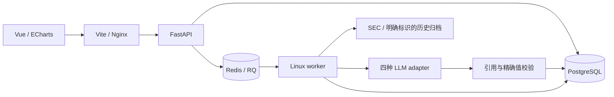
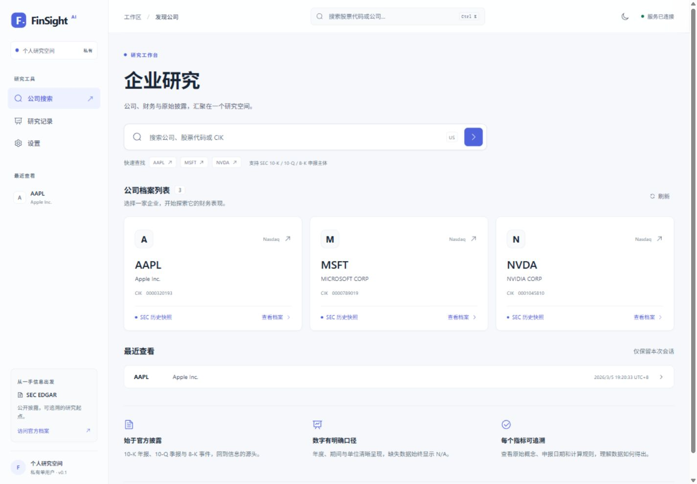
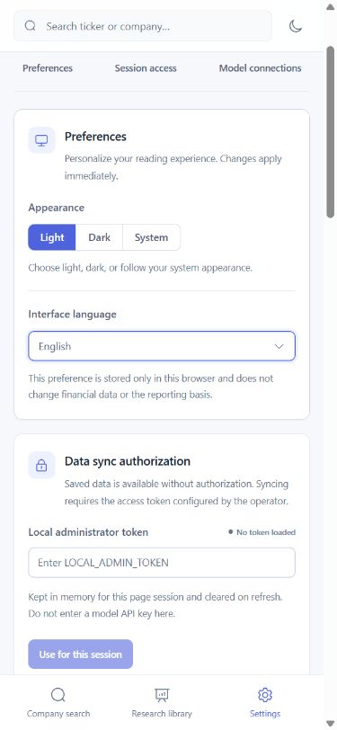
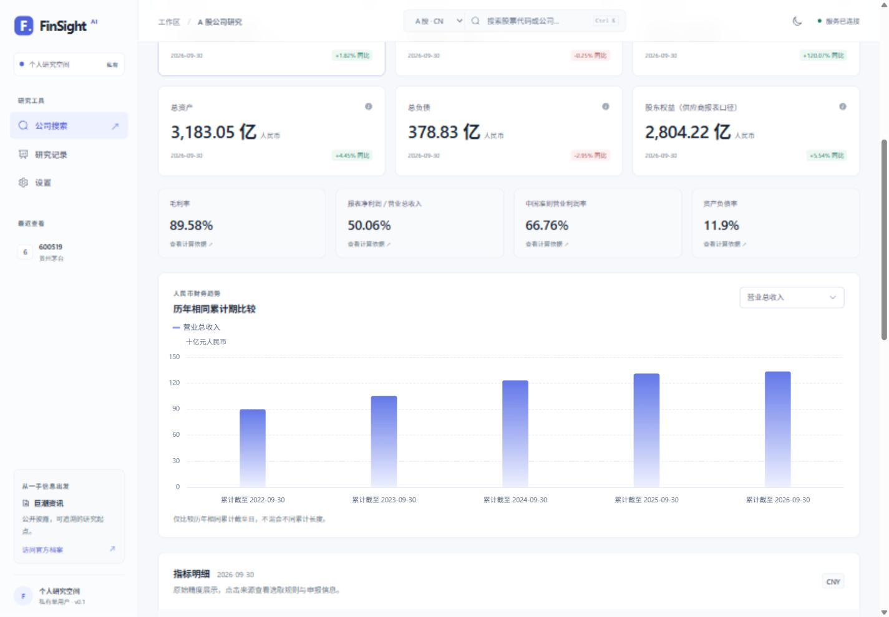

# FinSight AI

可追溯的美股与 A 股财务研究工作台。Vue 3 / TypeScript + FastAPI + PostgreSQL + Redis/RQ。美股支持 SEC 年度/季度财务、历史口径、申报/事件、全文证据与异步 AI 研究；A 股支持沪深京公司搜索、在线同步、人民币年度/累计财务、公告原文与来源快照。仅供研究和教育，不构成投资建议。

**交付目标（2026-11-04 更新）：桌面应用。** 根据用户的新要求，优先以当前开发环境对应的 Windows 桌面程序为目标：安装后双击打开独立窗口，由程序管理本地服务与数据。现有 Vue 界面和后端业务继续复用，浏览器地址用于开发调试。当前仓库尚未实现桌面宿主、自动管理的本地运行时或可安装的 `.exe`；已有源码 ZIP 和 Web 测试结果不代表桌面版已经交付。具体边界与验收项见[桌面交付目标](docs/DEPLOYMENT.md#桌面交付目标)。

**无模型 Key 也能使用真实历史财务与已保存正文的检索。** 当前为私有单用户 MVP，界面支持简体中文和 English；在“设置 → 偏好设置”选择语言及浅色、深色或系统主题。顶部公司搜索支持 Ctrl/Cmd K 和键盘选择。指标精确值按十进制字符串添加千位分隔，不经过浮点数舍入。

上传 GitHub 前运行 `python scripts/check_public_files.py`；源码、截图、配置示例与已知实际秘密的本轮检查结果、上传范围及提交邮箱隐私见[发布前隐私检查](docs/PRIVACY_REVIEW.md)。真实 `.env` 和本地运行资料保留在 Git 忽略范围，示例与测试凭据不用于正式运行。

## 实现与验收

| 能力 | 已实现的行为 |
|---|---|
| 确定性财务 | 实际财年期间、年度/季度、同比/比率、兼容口径的 YTD/Q4 差分；EPS/不可加指标和缺失资料显式保护 |
| 可追溯资料 | 最新重述/截至日期/指定申报，原始 concept 与操作数，原始 JSON、HTML 原字节与哈希、不可变正文版本 |
| 模型配置 | OpenAI、DeepSeek、Gemini、Ollama adapter，列表/手动 ID，参数、小型实际文本测试，加密与版本验证 |
| 研究任务 | 指标概览、定期报告总结/对比、8-K 解读、申报问答；冻结证据、缓存/幂等、取消/重试、历史、Markdown |
| 证据约束 | PostgreSQL FTS 与中文金融术语扩展；引用身份、精确值/单位和连续摘录校验；明确保留未知和语义验证边界 |
| 工程交付 | Alembic、隔离测试、CI 配置、Compose、本地服务恢复脚本、跨系统运行与展示文档 |

实际本地测试和浏览器验收见[测试记录](docs/TEST_RESULTS.md)。当前没有可用的真实云 Key/Ollama，直接 SEC 在线请求及真实 8-K 附件仍待验收；容器基础镜像下载亦有环境限制。协议/队列测试不等于真实模型推理，CI 配置不等于已有远程运行结果，Compose 配置不等于容器部署已通过。没有服务器/域名时不声称公网已部署。

## A 股使用

首页或顶部搜索选择“A 股 · CN”，输入中文名称或带交易所代码（如 `600519.SH`、`000001.SZ`、`920000.BJ`）。首次在设置中输入管理员令牌，回首页更新 A 股目录，再进入公司同步真实资料。已有资料可免授权查看；目录包含历史证券标识，不是实时上市状态或行情。

A 股结构化数据来自东方财富第三方整理，目录及财报 PDF 链接来自巨潮资讯。当前获取链路无需 A 股 API Key、AI Key 或 SEC 联系邮箱。已实际完成沪深京三家公司 API → RQ worker → PostgreSQL 同步，最新取得的报告期均为 2026-09-30；这不代表全目录每家公司或所有历史期间均已验收。

`CN_DATA_MODE=cn_live` 与 SEC `DATA_MODE` 独立，分别绑定独立表及来源。现有用户先执行 `python scripts/manage.py migrate` 并重启 API/worker。也可从根目录用 CLI 初始化：

```sh
python scripts/manage.py cn-refresh-directory
python scripts/manage.py cn-sync --symbol 600519.SH
```

年初至今保持累计值，同一累计截止日跨年比较；归母净利润与报表净利润、营业总收入与营业收入分别展示。**A 股 PDF 正文解析及 AI 研究尚未接通，历史当时已知口径和单季度差分尚未提供。** 来源、部署配置、完整范围和边界见 [A 股说明](docs/A_SHARE_SUPPORT.md)。

## 数据真实性

`data/snapshots/` 包含 AAPL、MSFT、NVDA 的真实 SEC JSON 历史归档；`data/documents/` 包含 Apple FY2024 10-K、2024-06-29 期末 10-Q 和 NVIDIA FY2023 10-K。文件来自 MIT 许可的 EdgarTools 固定 Git 版本，**不是本次直接 SEC 下载，也不是实时资料**。每份原始 URL、第三方归档、时间、commit、原字节 SHA-256 与许可见[data说明](data/README.md)和[正文说明](data/documents/README.md)。没有真实 8-K/EX-99.1 正文样本。

`sec_live`、`sec_snapshot`、`synthetic_fixture` 必须使用独立数据库；模式与数据库绑定不符时拒绝服务。合成财务、HTML、模型响应只用于隔离测试，不混入上述真实归档或生产报告。在线失败保留旧缓存，不自动切换测试数据。

## 启动

完整的 Windows/macOS/Linux 前提、环境变量、首次同步、模型与 Docker 网络、备份恢复和排错见[部署指南](docs/DEPLOYMENT.md)。命令从项目根目录执行。

首次复制 `.env.example` 为 `.env`，填独立随机 `POSTGRES_PASSWORD` 和至少 16 字符的 `LOCAL_ADMIN_TOKEN`。建议使用独立随机十六进制值；不要提交或公开 `.env`。

历史演示将 `DATA_MODE=sec_snapshot`，以独立 Compose 项目启动：

```sh
docker compose -p finsight-snapshot up --build -d
docker compose -p finsight-snapshot exec api python -m app.cli import-snapshot --directory /data/snapshots/0000320193
docker compose -p finsight-snapshot exec api python -m app.cli import-snapshot --directory /data/snapshots/0000789019
docker compose -p finsight-snapshot exec api python -m app.cli import-snapshot --directory /data/snapshots/0001045810
```

访问 [Compose 首页](http://127.0.0.1:8080) 和 [API 文档](http://127.0.0.1:8000/docs)。正文另按部署指南导入，不能把仅有申报元数据当成正文已就绪。镜像下载受限时使用下面已经安装依赖的裸机/WSL 路径，并保留容器验收缺口。

裸机需要 Python 3.12、PostgreSQL、Redis、Node 24、pnpm 11.25.0；后端安装 `backend/requirements.lock` 后 `pip install --no-deps -e backend`，根 `.env` 配好独立数据库、Redis 和当前系统可见的归档路径：

```sh
python scripts/manage.py migrate
python scripts/manage.py import-snapshots
python scripts/manage.py serve
# 另一个 Linux/WSL 终端
python scripts/manage.py worker
# 前端终端
cd frontend
pnpm install --frozen-lockfile
pnpm dev
```

访问 [开发首页](http://127.0.0.1:5173)。Vite 默认代理 `127.0.0.1:8000`，可设置 `API_PROXY_TARGET`。当前已有 Windows/WSL 环境重启后，用以下命令恢复服务和自动探测代理地址；它不安装环境或配置开机自启：

```powershell
powershell -NoProfile -ExecutionPolicy Bypass -File scripts/start_local.ps1
```

在线模式需新的 `sec_live` 数据库/项目、真实 `SEC_USER_AGENT`（应用名和联系邮箱）及可达网络，再运行 `refresh-tickers`、在设置页授权并选择公司同步。遵循 [SEC Fair Access](https://www.sec.gov/search-filings/edgar-search-assistance/accessing-edgar-data)，不使用占位邮箱提交真实请求。

## AI 与安全边界

启用云 Key 前，用已安装后端依赖的 Python 执行 `python scripts/init_ai_key.py`，将稳定的主密钥写入本地 `.env`；已有有效值不覆盖、不打印。API/worker 必须使用相同主密钥。主密钥与数据库分别安全备份，丢失后原云 Key 无法解密。

设置页保存 Key/模型 → 自动枚举或手填 ID → 小型实际文本测试 → 选择已验证配置。修改 Key、模型、参数或部署 origin 后需重新测试；模型列表存在不证明可调用。Ollama origin 只由部署者的 `OLLAMA_BASE_URL` 配置，Compose 后端的 localhost 指容器自身；宿主连接方式及远程限制见部署指南。当前没有自动安装或下载 Ollama 模型。

管理员令牌仅存页面内存，刷新清除；模型 Key 只在后端加密存储，不随查询返回。私有历史、下载与所有管理操作都检查服务端身份。除本机 loopback 开发访问外使用 HTTPS 私有入口；当前没有公开多租户认证，也没有通用 DNS 固定防护。

研究冻结所选申报、片段、精确事实、文档/配置/提示版本与语言。报告分开显示披露事实、模型推论、未知与方法限制。**摘录匹配和数值一致不证明语义正确或语境完整**，相关性与推论支持仍需人工核查。取消阻止结果发布，不保证上游调用停止或免计费。生产模型失败不会返回 Fake 分析。

## 测试

```sh
# 后端虚拟环境，backend 目录
python -m ruff check .
python -m pytest -q
# frontend 目录
pnpm typecheck
pnpm lint
pnpm test
pnpm build
# 自动浏览器回归（先安装浏览器）
pnpm test:e2e:install
pnpm test:e2e:check
pnpm test:e2e
```

真实 PostgreSQL 集成测试只允许专用 `TEST_DATABASE_URL`（库名含 `_test`），会迁移并清理该库；RQ 测试用独立 `TEST_REDIS_URL`，例如 DB15。未设置时相关测试明确跳过，不等于全部集成通过。不要指向真实资料库和生产队列。更多范围、浏览器流程和结果见[测试计划](docs/TEST_PLAN.md)与[测试记录](docs/TEST_RESULTS.md)。

浏览器回归使用4173/18000独立端口、真实历史归档和临时开发数据库，不读取根`.env`。默认SQLite验证其明确的PostgreSQL检索限制；指定专用`_e2e_test` PostgreSQL库才能验收真实FTS。CI配置包含该分支；本机亦已用独立PG及无头Edge完成，详见[E2E说明](frontend/e2e/README.md)。下载受限时可用已安装的浏览器设置`FINSIGHT_E2E_CHANNEL=msedge`或`chrome`。

## 架构



采用模块化单体，API/worker 共享领域服务；没有为了演示加入不必要的微服务或强制向量模型。完整数据流和事务边界见[架构说明](docs/ARCHITECTURE.md)及[决策记录](docs/ARCHITECTURE_DECISIONS.md)。

## 真实运行截图

下列截图为 2026-11-04 视觉重构后的实际 Vue/FastAPI/PostgreSQL 服务，展示真实 SEC 历史归档。模型相关画面表示真实配置/未授权状态，不是生产成功报告。设计审查及规范见 [UI/UX 审查](docs/UI_UX_REVIEW.md)与[设计系统](docs/DESIGN_SYSTEM.md)。










原阶段验收截图仍保留在 `docs/screenshots/01` 至 `28` 对应文件中，用于记录历次验收，不表示当前视觉。

## 文档与演示

| 文档 | 内容 |
|---|---|
| [产品说明](docs/PRD.md) | 产品目标、范围与保留的五阶段路线 |
| [架构说明](docs/ARCHITECTURE.md) / [架构决策](docs/ARCHITECTURE_DECISIONS.md) | 数据流、版本/事务、技术取舍与安全边界 |
| [API](docs/API.md) / [数据字典](docs/DATA_DICTIONARY.md) | 请求、错误、精度与数据字段 |
| [部署指南](docs/DEPLOYMENT.md) | 跨系统启动、SEC/Ollama 网络、备份恢复、排错 |
| [测试计划](docs/TEST_PLAN.md) / [测试记录](docs/TEST_RESULTS.md) | 测试层次、实际命令/结果和未验证项 |
| [UI/UX 审查](docs/UI_UX_REVIEW.md) / [设计系统](docs/DESIGN_SYSTEM.md) | 视觉问题、页面重构、主题 token、组件状态与响应式规则 |
| [A 股支持](docs/A_SHARE_SUPPORT.md) | 沪深京接入、人民币口径、巨潮公告、独立来源与运行步骤 |
| [安全验收](docs/SECURITY.md) | 实测权限、注入、凭据与故障边界 |
| [演示流程](docs/DEMO.md) / [简历素材](docs/RESUME.md) | 无 Key 的真实路径、可证实的中英项目描述 |
| [任务清单](docs/TASKS.md) | 开发进度及下一项验收缺口 |

原始需求保留于 `FinSight_AI_Codex_Implementation_Brief.md`。实现与验收分别追踪，尚未完成的在线或部署检查不会因文档齐备而标为通过。
