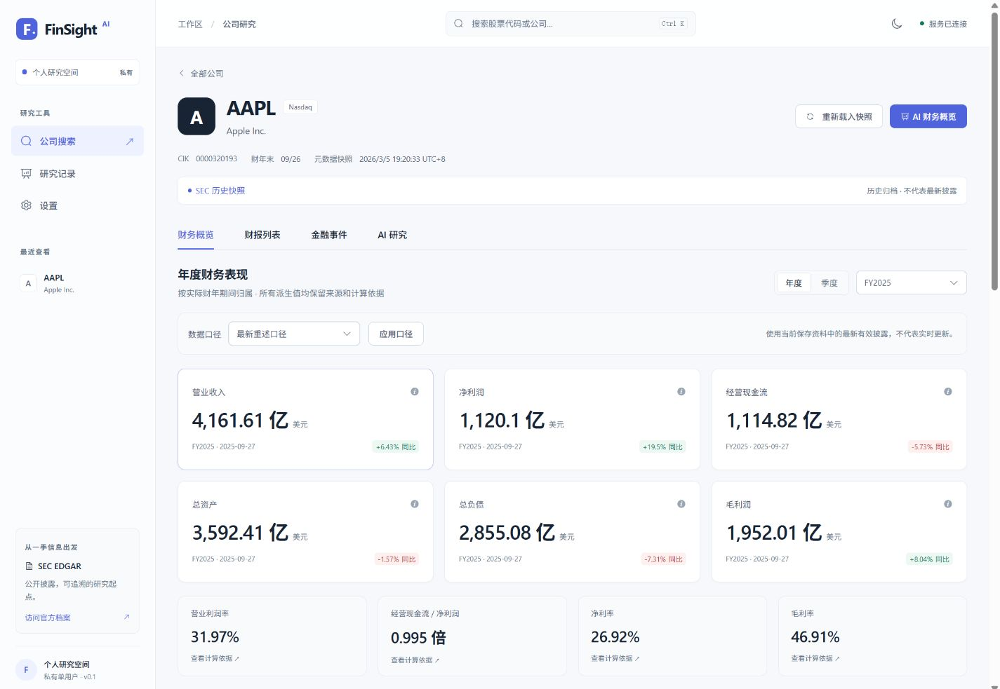
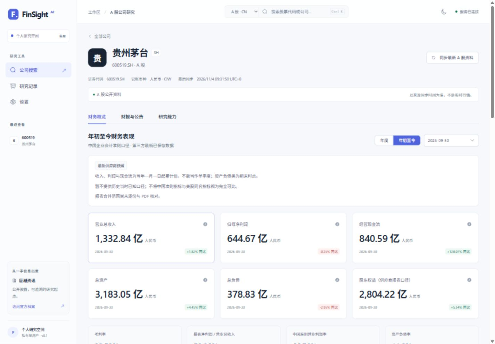
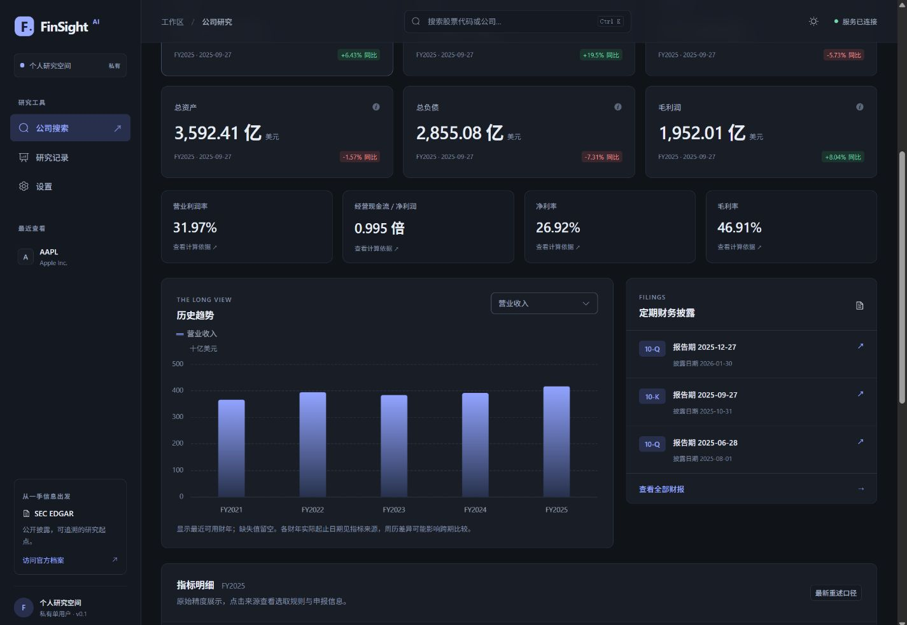
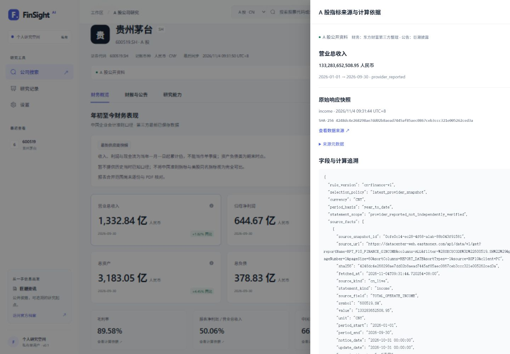
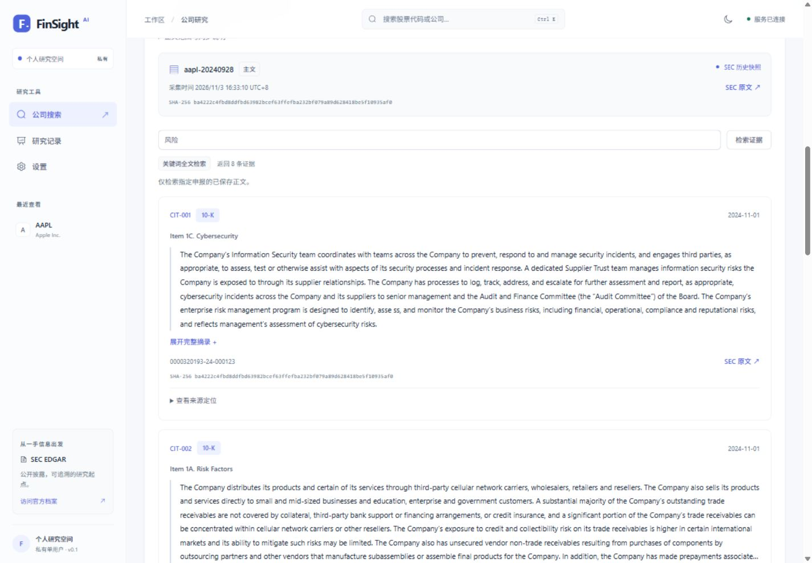
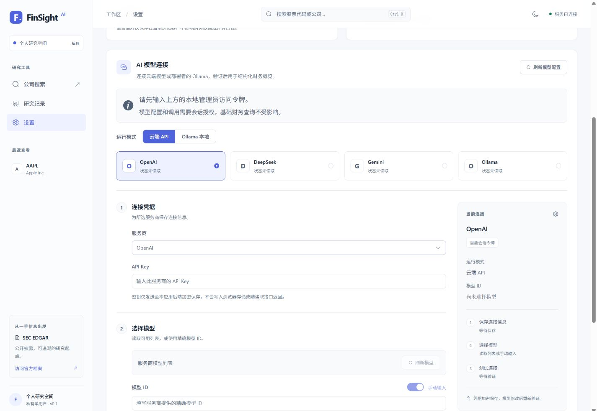
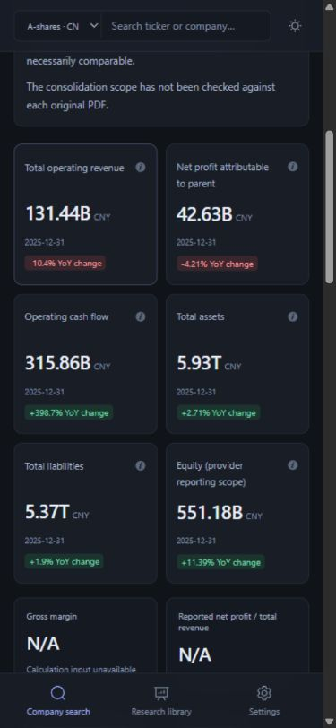
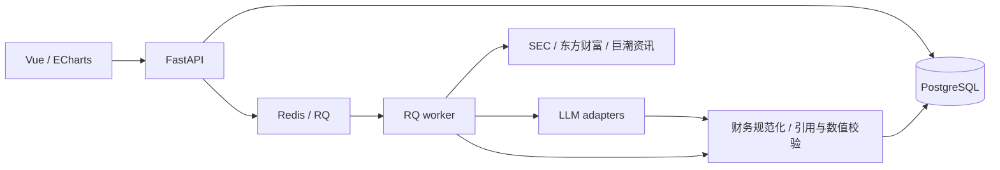

# FinSight AI

**可追溯的美股与 A 股财务研究工作台**

Traceable financial research for US and China A-share markets.

[](https://github.com/Craft-s/FinSight-AI/actions/workflows/ci.yml)

FinSight AI 将公司财务、财报原文与 AI 研究放在同一工作台中。项目围绕真实数据、精确计算和来源追溯构建：财务指标保留原始字段、计算操作数和版本信息，正文研究保留可追溯的文档片段。

前端采用 **Vue 3 + TypeScript**，后端采用 **FastAPI + PostgreSQL + Redis/RQ**。界面支持简体中文、English、浅色/深色主题和移动端布局。

> 当前版本可通过源码或 Docker 在本地运行，财务浏览与已保存正文的检索无需模型 Key。最终交付目标为 Windows 桌面应用；桌面宿主、本地运行时管理和 `.exe` 安装包尚未实现。



## 项目能力

| 能力 | 美股 · US | A 股 · CN |
|---|---|---|
| 公司搜索 | 公司名称、Ticker、SEC CIK | 中文名称、六位代码及沪深京交易所标识 |
| 财务指标 | 年度/季度、同比、利润率、资产负债指标 | 人民币年度/年初累计、同比及可验证比率 |
| 披露口径 | 最新重述、截至日期、指定申报版本 | 最新保存的供应商报表快照 |
| 来源追溯 | SEC concept、精确值、操作数、申报及原文版本 | 原始响应页、报表字段、快照与 SHA-256 |
| 财报与公告 | 10-K、10-Q、8-K 列表及受控正文准备流程 | 巨潮财报公告列表与官方 PDF 链接 |
| 正文检索 | HTML 清洗分块、PostgreSQL 全文检索 | PDF 正文解析待实现 |
| AI 研究 | 模型适配、异步研究、证据校验、历史与 Markdown 导出 | AI 研究与事件证据链待实现 |

### 精确的财务计算与展示

- 后端使用 Decimal/NUMERIC 处理财务数值，API 保留精确十进制字符串，前端精确值展示支持千位分隔符。
- 美股按实际财年期间及兼容披露版本计算；累计值差分对 EPS、比率、缺失和不可比资料做显式保护。
- A 股区分营业收入/营业总收入、报表净利润/归母净利润、货币资金/现金等价物；累计图表按相同截止日跨年比较。
- 图表单独转换显示单位，指标详情保留精确值、来源与计算依据。

### 有证据边界的 AI 研究

- 适配 OpenAI、DeepSeek、Gemini 和 Ollama，支持自动读取模型列表及手动输入模型 ID。
- 模型凭据在后端加密存储，配置通过实际连接测试接口验证后方可启用。
- 异步任务冻结所选财报、指标、证据和配置版本，支持幂等、重试、取消、研究历史及 Markdown 导出。
- 校验结构化输出、引用身份、精确数值和连续摘录，区分披露事实、模型推论与未知。

模型适配和研究流程已实现；真实云模型/Ollama 推理仍待在线验收。引用存在、数值一致和摘录匹配不能证明结论在语义上得到充分支持。

## 界面预览

下列画面来自实际运行的应用。美股展示真实 SEC 历史归档；A 股展示实际在线同步后保存的数据。没有用合成 AI 报告作为产品成果展示。



<details>
<summary>查看更多界面：深色主题、来源明细、正文检索与模型设置</summary>







</details>

## 技术架构

| 层级 | 技术 |
|---|---|
| 前端 | Vue 3、TypeScript、Vite、Pinia、Vue Router、Axios |
| 界面与可视化 | Element Plus、ECharts、语义化 CSS Design System |
| 后端 | Python 3.12、FastAPI、Pydantic、SQLAlchemy、Alembic |
| 数据与异步任务 | PostgreSQL、Redis、RQ |
| 正文与检索 | BeautifulSoup、lxml、PostgreSQL FTS |
| 模型适配 | OpenAI、DeepSeek、Gemini、Ollama |
| 测试与质量 | pytest、Ruff、Vitest、ESLint、vue-tsc、Playwright |
| 工程与运行 | GitHub Actions、Docker Compose、Nginx |



采用模块化单体，API 与 worker 共享领域服务。正文检索使用 PostgreSQL 关键词全文检索；来源快照、文档版本和研究输入分别保留。数据流与事务边界见[架构说明](docs/ARCHITECTURE.md)和[架构决策](docs/ARCHITECTURE_DECISIONS.md)。

## 快速启动

### 本地历史数据演示

需要可用的 Docker Engine / Docker Desktop 和 Compose。首次克隆后复制配置示例；已有 `.env` 时保留原配置。

```sh
git clone https://github.com/Craft-s/FinSight-AI.git
cd FinSight-AI
cp .env.example .env
```

编辑 `.env`：将 `DATA_MODE` 设为 `sec_snapshot`，为 `POSTGRES_PASSWORD` 和 `LOCAL_ADMIN_TOKEN` 分别填写独立随机值；管理员令牌至少 16 个字符。建议使用随机十六进制字符串。历史演示无需 SEC 联系邮箱和模型 Key。

```sh
docker compose -p finsight-demo up --build -d --wait

# 导入 Apple 的真实历史财务与 FY2024 10-K 正文
docker compose -p finsight-demo exec api python -m app.cli import-snapshot --directory /data/snapshots/0000320193
docker compose -p finsight-demo exec api python -m app.cli import-document --manifest /data/documents/0000320193/0000320193-24-000123/manifest.json
```

打开[本地工作台](http://127.0.0.1:8080)，搜索 `AAPL` 查看财务、申报和已导入的正文证据。API 文档位于 [Swagger UI](http://127.0.0.1:8000/docs)。仓库另含 MSFT、NVDA 的历史 JSON 和两份其他财报 HTML，导入方法见[运行指南](docs/DEPLOYMENT.md)。

### 同步 A 股资料

A 股默认使用独立的 `CN_DATA_MODE=cn_live`，可与美股历史模式共用 PostgreSQL 的不同业务表。进入“设置”输入自己的管理员令牌，切换“A 股 · CN”后更新公司目录，再搜索公司并同步资料。也可通过 CLI 初始化：

```sh
docker compose -p finsight-demo exec api python -m app.cli cn-refresh-directory
docker compose -p finsight-demo exec api python -m app.cli cn-sync --symbol 600519.SH
```

A 股当前使用东方财富结构化财务数据和巨潮公司目录/财报链接，无需额外模型 Key 或 SEC 联系邮箱。已完成沪、深、京三家公司的真实在线同步验证；详细口径及覆盖限制见[A 股说明](docs/A_SHARE_SUPPORT.md)。

美股直接在线同步需要新的 `sec_live` 数据库、真实 `SEC_USER_AGENT` 联系信息及可用网络。数据模式绑定后不能直接在原库切换。原生 Python/Node 开发、Windows/WSL、模型配置和备份步骤见[运行指南](docs/DEPLOYMENT.md)。

## 测试与验证

已完成的 GitHub Actions 验证见[成功运行记录](https://github.com/Craft-s/FinSight-AI/actions/runs/41795833117)，对应提交 `0ed9a17`：

| 检查 | 已验证结果 |
|---|---|
| 后端 | Ruff、依赖一致性、584 项测试，使用独立 PostgreSQL/Redis |
| 前端 | Lint、48 项单元测试、TypeScript 与生产构建 |
| 浏览器 | 类型/Lint、14 项 Chromium 端到端测试，使用独立 PostgreSQL |
| 发布保护 | 10 项回归及 Git 工作树/暂存区隐私检查 |
| 容器 | Compose 构建、启动、真实归档导入与 HTTP 烟雾测试 |

本地常用检查：

```sh
# 后端虚拟环境，backend 目录
python -m ruff check .
python -m pytest -q

# frontend 目录
pnpm typecheck
pnpm lint
pnpm test
pnpm build
pnpm test:e2e:check
pnpm test:e2e
```

PostgreSQL/RQ 测试需要独立的 `TEST_DATABASE_URL` 与 `TEST_REDIS_URL`，浏览器测试还需安装 Playwright 浏览器；测试会清理专用测试库，请使用与应用资料分离的数据库和队列。未配置依赖而跳过的测试不计为集成验收。详见[测试计划](docs/TEST_PLAN.md)、[测试记录](docs/TEST_RESULTS.md)和[E2E 指南](frontend/e2e/README.md)。

## 开发路线与当前边界

| 阶段 | 当前进度 |
|---|---|
| 1. 数据闭环 | 公司搜索、同步、存储、财务指标和申报列表已实现 |
| 2. 财务与版本 | 期间规范化、同比/比率、历史口径与来源追溯已实现 |
| 3. 模型配置 | 四种适配器、加密配置与概览流程已实现；真实推理待验收 |
| 4. 检索与研究 | 正文检索、证据约束及异步研究流程已实现；真实生成与语义评估待验收 |
| 5. 工程交付 | 远程 CI 和容器闭环已通过；Windows 桌面宿主与安装包待实现 |

当前应用面向个人本地使用，采用单用户权限模型。A 股尚未提供 PDF 正文解析、AI 研究、单季度差分和历史 as-of/as-filed；美股 SEC 直连及真实 8-K 附件在线链路仍待验收。项目没有提供实时行情，也未完成全市场逐家公司核验。

## 数据来源与许可

- 美股演示使用 AAPL、MSFT、NVDA 的真实 SEC JSON 历史归档，以及三份真实财报 HTML，取自固定版本的公开 EdgarTools 归档。它们是历史资料；原始 URL、归档版本、时间、SHA-256 和第三方许可见[数据说明](data/README.md)与[正文说明](data/documents/README.md)。
- A 股结构化指标来自东方财富第三方整理，公告原文链接来自巨潮资讯。第三方报表口径与原始披露可能存在差异，资料应结合原文核查；公开接口访问不代表商业再分发授权。
- 合成财务、HTML 和模型响应仅用于明确标识的隔离测试，生产失败不会回退到合成数据或 Fake 分析。
- **项目源码许可证尚未选定。** 第三方归档保留其来源与许可声明。

仅供研究和教育，不构成投资建议。

## 文档导航

| 文档 | 内容 |
|---|---|
| [产品说明](docs/PRD.md) / [开发任务](docs/TASKS.md) | 产品范围、五阶段路线与进度 |
| [架构说明](docs/ARCHITECTURE.md) / [架构决策](docs/ARCHITECTURE_DECISIONS.md) | 数据流、事务、异步任务与技术取舍 |
| [API](docs/API.md) / [数据字典](docs/DATA_DICTIONARY.md) | 接口、数据字段、精度和错误语义 |
| [运行指南](docs/DEPLOYMENT.md) | 本地运行、桌面目标、模型配置、备份与排错 |
| [A 股说明](docs/A_SHARE_SUPPORT.md) | 市场标识、人民币口径、公告和来源限制 |
| [测试计划](docs/TEST_PLAN.md) / [测试记录](docs/TEST_RESULTS.md) | 验证方法、执行结果与未验收项目 |
| [设计系统](docs/DESIGN_SYSTEM.md) | 主题、排版、组件状态和响应式规则 |
| [安全说明](docs/SECURITY.md) / [隐私检查](docs/PRIVACY_REVIEW.md) | 权限、凭据、来源保护与发布检查 |

提交配置、日志或新增截图前运行 `python scripts/check_public_files.py`；真实 `.env`、密钥、数据库和运行资料不纳入 Git。
