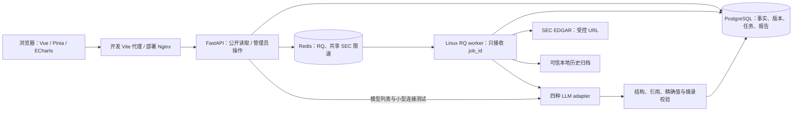
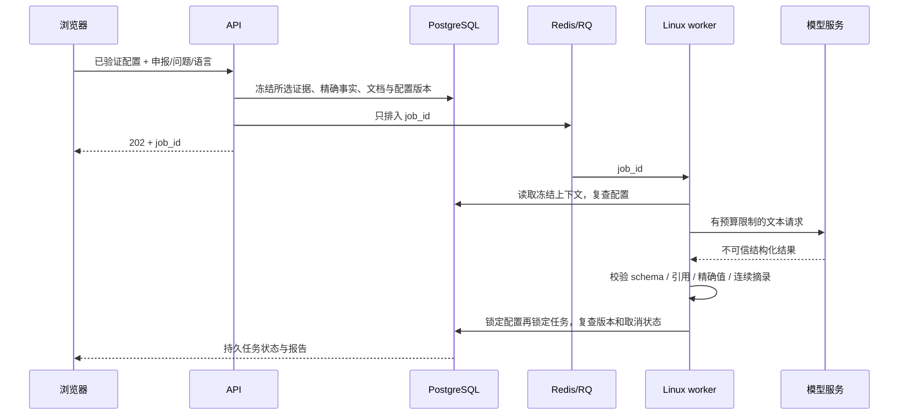

# FinSight AI 架构

系统采用模块化单体：Vue/TypeScript 展示资料，FastAPI 提供 API，PostgreSQL 保存业务状态与证据，Redis/RQ 将耗时任务交给 Linux worker。API 与 worker 共享领域服务和同一套迁移，不引入额外微服务、向量数据库或必须下载的模型。

## 运行组件

Compose 运行 PostgreSQL、Redis、一次性 migrate、API、worker 和前端。只有 API/前端端口绑定宿主 loopback；数据库/Redis 不发布宿主端口。前端在 API readiness 通过后启动；长模型测试的代理超时与应用预算对齐。当前本地 Windows 开发由前端连接 WSL 私有地址，`scripts/start_local.ps1` 负责恢复已有环境及探测该地址。

## 模块与责任

| 路径 | 责任 |
|---|---|
| `frontend/src/pages`、`components` | 搜索、期间/来源、模型设置、研究工作台、历史和详情 |
| `frontend/src/i18n.ts`、`locales` | 语言注册、翻译与格式化，设置页下拉切换 |
| `backend/app/core` | 环境配置、鉴权、错误信封、加密与安全边界 |
| `backend/app/services/sec`、`sync.py` | 固定 SEC 端点、共享限速、快照导入、同步事务 |
| `backend/app/services/cn`、`api/cn.py`、`db/cn_models.py` | A股独立身份/来源模式、东方财富与巨潮适配、人民币规范化、分页批次与RQ同步 |
| `backend/app/services/finance`、`metrics.py` | 期间分类、精确计算、指标口径与来源选择 |
| `backend/app/services/llm`、`llm_configs.py` | 服务商 adapter、配置版本/加密/验证、错误归一 |
| `backend/app/services/overview.py` | 结构化指标概览与冻结事实 |
| `backend/app/services/documents` | 受控正文/附件获取、HTML 清洗、不可变文档与 FTS |
| `backend/app/services/research` | 冻结上下文、任务、严格输出校验与安全 Markdown |
| `backend/app/db`、`migrations` | 领域模型、数据模式绑定、唯一约束及唯一迁移来源 |

## 财务数据流

公司名/ticker/CIK 查询缓存 → 用户确认 CIK → 管理员提交同步 → 持久化任务并入队 → worker 按数据模式读取 SEC 或已有归档 → 保存原始 JSON/事实/申报 → 确定性规范化 → 返回指标与逐项来源。

金额使用 Decimal/NUMERIC，API 采用精确十进制字符串；前端按字符串分组千位数，图表单独换算展示单位。原始事实不会被最新指标视图覆盖。`latest_restated`、`as_of` 和 `as_filed` 重新选择兼容的事实，不把“当前保存的最新值”等同于实时或历史当时已知值。YTD/Q4 差分只用于可加金额，EPS/比率和不兼容重述拒绝差分。详细规则和字段见[数据字典](DATA_DICTIONARY.md)。

数据模式与数据库单例绑定，`sec_live`/`sec_snapshot`/`synthetic_fixture` 必须隔离。`filed_at` 是事实披露时间，财务期间有自己的起止时间；抓取、归档下载及公司快照日期各自记录，不能互相替代。在线失败保留旧资料及陈旧状态，不回退为合成数据。

## 正文与检索

用户选择已有 filing_id；服务器只允许对应 accession 目录内的正文和经索引确认的 EX-99.1 HTML 附件。SEC 客户端不跟随重定向、不采用环境代理，并限制解压后的响应大小；Redis 限速不可用时停止联网。缺少真实 SEC 联系信息时明确报错。

`documents` 保存原始字节、SHA-256、角色、来源、解析版本；变化产生新版本。`document_chunks` 保存章节、表格上下文、稳定的 JSON 位置和内容哈希。生产检索使用 PostgreSQL 英文 FTS/GIN 索引及有限中文金融术语扩展。`section_fallback` 只表示章节候选，`test_keyword` 只限 SQLite 合成测试；均不伪装为向量/语义检索。未指定申报时范围为最近十份已有正文的申报，页面显示范围，未命中不等于原财报无该信息。

## AI 配置和研究事务

云 Key 以 Fernet 加密保存，绑定固定 owner 和服务商，不返回明文/密文。四 adapter 统一模型列表、文本生成、用量与错误；服务商能力未知时保留未知状态。Ollama origin 仅由部署者环境配置。

配置有版本号和验证部署 binding（主密钥/受控地址等）。更改 Key、模型、参数或部署绑定后需重新测试，长任务不能给新配置误盖旧测试结果。模型列表、小型测试在 API 执行；指标概览和正文研究通过 RQ 执行。

缓存指纹包括 owner、配置版本/binding、资料与提示/schema 版本、语言等。在途唯一键防重复提交，成功缓存可显式绕过；不跨身份或资料版本复用。重试新建任务并保留原冻结输入和父任务，不覆盖历史报告。取消阻止发布，但不证明上游调用停止。任务状态存于 PostgreSQL，Redis 不是唯一状态来源；丢失 Redis 队列并不意味着所有未执行任务会自动重放。

## 可信性与权限边界

当前固定私有单用户身份。只读公司/证据端点公开给部署环境；写操作、AI 配置、研究历史与下载需要 `X-Admin-Token`。令牌仅在页面内存，刷新后清除；语言枚举可以持久化。CORS 不是身份认证，当前方案也不是多租户 RBAC。

模型不能提供来源 URL、原文或哈希；这些字段来自冻结上下文。精确复制值与单位必须一致；披露事实要求在每个所引片段中连续匹配；推论只检查引用身份，语义支持始终明确未自动验证。页面以文本渲染原文和模型结果，Markdown 转义不可信内容，只为合规 SEC 来源生成链接。

固定目的地址、无重定向、受控 origin 和危险地址校验降低 SSRF 风险，但没有实现通用 DNS 固定；部署者不能把不可信域名列入允许范围。私人远程部署需 HTTPS、受控入口和独立备份，不能直接把当前本地开发服务公开为多用户服务。

关键取舍及原因见[架构决策](ARCHITECTURE_DECISIONS.md)，实际测试与在线缺口见[测试记录](TEST_RESULTS.md)，运行、更新和恢复步骤见[部署指南](DEPLOYMENT.md)。

## A 股数据域

新增`/api/v1/cn`和`/cn/company/:symbol`独立入口，股票代码不进入CIK或SEC研究链。复用PG/Redis/RQ现有进程，但使用四张CN表及独立模式绑定；因此SEC历史演示可与A股实际在线资料共存，界面逐市场/记录标明来源，不能用全局SEC health标记替代CN来源。

目录确认证券及orgId → 持久化任务/RQ → 受控东方财富G/B/I/S财务和巨潮公告 → 各页原字节/hash → Decimal年度/累计规范化 → 在公司行锁下原子发布source-ID清单。读取时按清单合并所有页，逐行追到准确版本；目录刷新同样加锁并刷新ORM，防覆盖新财务指针。失败、空表和不完整分页不发布部分结果。

A股正文PDF目前只提供来源外链，不进入SEC的HTML/FTS/AI证据验证。合并范围、累计口径和后续能力边界详见[A股说明](A_SHARE_SUPPORT.md)；原五阶段实现保留，A股为追加扩展。
