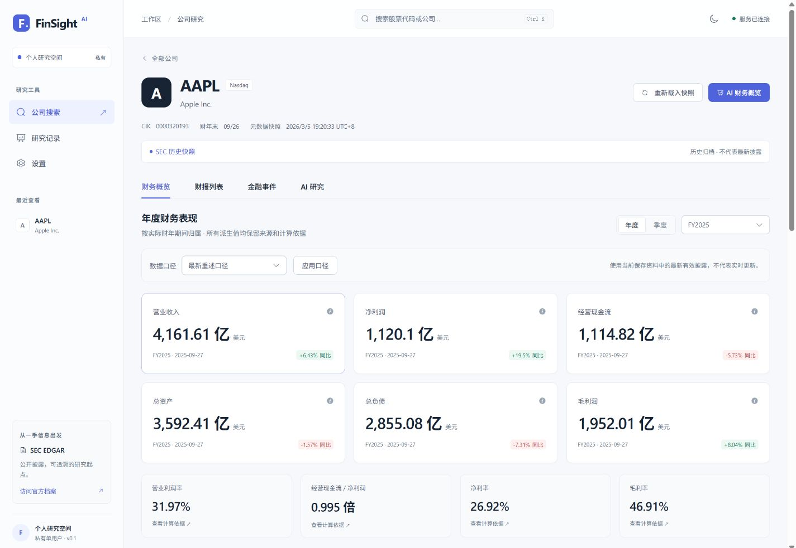
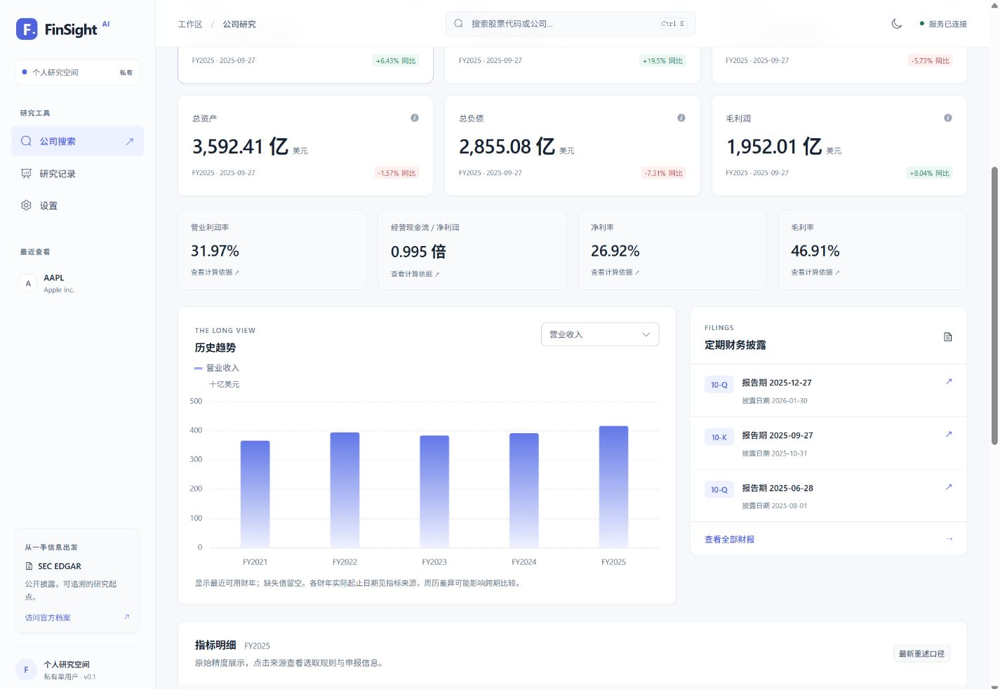

# UI/UX 审查与视觉重构

审查记录更新：2026-11-04。本轮交付是现有 FinSight AI 前端的实际视觉和交互改造，保留原路由、API 契约、财务计算、数据结构、权限及后端能力。

设计以专业金融研究工作台为目标：[Koyfin](https://www.koyfin.com/features/)用于参考财务信息的组织与比较，[Linear](https://linear.app/features/)用于参考排版、间距和工作区一致性。FinSight 按自身的 SEC 来源、确定性财务和证据约束研究功能设计，没有照搬参考网站页面。

## 改造前的问题

审查覆盖 `App.vue`、首页、公司页、图表、指标与来源抽屉、设置、AI 概览、研究输入、研究记录、任务/报告页、证据卡片以及全局 CSS。此前截图可见[旧公司页](screenshots/23-metric-spacing.jpg)、[旧模型设置](screenshots/22-model-settings-preview.jpg)与[旧证据页](screenshots/24-real-filing-evidence.jpg)。

| 问题 | 对研究体验的影响 | 本轮实际处理 |
|---|---|---|
| 主色、背景、图表和组件颜色多处硬编码，只有深色风格 | 控件与图表缺少统一语义，难以扩展主题 | 引入浅/深语义 token，映射 Element Plus，图表读取相同变量 |
| 橄榄绿强调色覆盖大量区域，细小的辅助文字密度偏高 | 重要数据、说明与操作不易区分 | 改用中性灰蓝画布、蓝紫操作色，分开标题、正文、元数据和金额层级 |
| 左导航较重，顶部缺少跨页公司搜索 | 切换企业依赖返回首页，导航与研究内容争夺空间 | 224px 工作区侧栏、窄屏图标栏、手机底栏，新增真实全局搜索 |
| 公司信息、期间/口径筛选、金额卡片与比率卡片较分散 | 缺少从企业身份到当前期间再到详细证据的阅读顺序 | 企业头部 → 来源状态 → 期间/口径 → KPI/同比 → 比率 → 趋势/财报 → 精确表格 |
| KPI 主要突出数值，跨期背景和趋势层次不足 | 浏览时需要反复查表才能理解当前期间 | 展示后端已有可比同比，趋势与定期财报并排，保留精确值及来源入口 |
| 图表颜色固定、轴/图例/Tooltip 与页面割裂 | 不同主题下阅读不一致，窄屏标签拥挤 | 主题色、弱化网格、单序列图例、精确值安全 DOM Tooltip、自适应标签 |
| 研究输入、模型条件、任务和结论缺少明确分区 | 容易把准备条件、正在分析和已验证事实混在一起 | 分步输入、实际任务状态、事实/推论/未知分组，证据独立成卡片 |
| 设置中的 Key、模型列表、手动 ID 和验证按钮集中堆叠 | 不易理解应先保存、再选模型、再测试和启用 | 三步模型流程与状态侧栏，清晰区分云端/本地、空列表/未读取和待验证 |
| 部分空态、加载和失败提示表达较泛 | 用户难以判断是没有资料、没有权限还是网络问题 | 对应场景的骨架、空态、错误重试、授权提示和 Toast；保留禁用原因 |
| 移动端虽能访问，但工作区、图表及长数据缺少整体规范 | 容易出现拥挤和难以发现的表格横向滚动 | 内容驱动断点、两列 KPI、单列研究/设置、表格滚动提示与 safe-area |

## 已落地的设计

[Design System](DESIGN_SYSTEM.md)记录可维护的颜色、字号、间距、圆角、阴影、组件状态、主题和响应式规则。代码继续复用 Vue 3 + TypeScript + Element Plus + ECharts；没有引入 Tailwind 或 shadcn-vue，也没有为视觉改造替换表单、日期与表格交互体系。

### 公司财务概览

企业名称、ticker、交易所与 CIK 具有明确主次；快照时间和历史归档声明保持可见。期间与口径集中在 KPI 上方，核心金额三列，比率用较轻背景承载；两组之间保留 20px 间距，手机 16px。

同比直接使用后端已有数据，没有在前端重新计算。金额、单位、财期、变化方向分开排版。趋势旁提供三份定期财报预览，完整财报和事件 tab 仍保留。精确表格、来源抽屉、年度/季度及历史口径功能继续可用。

### 图表

主题色、字体、网格、图例与页面一致。金额柱形与比例/EPS 折线按单位显示，缺失值留空、零值保留。Tooltip 展示实际期间、精确数字和单位，长数字可换行且不经过浮点舍入；使用 `textContent` 防止外来文字作为 HTML 执行。容器尺寸、语言和主题变化触发更新，并遵循减少动态效果偏好。

### 研究与证据

研究范围、资料准备、模型条件与提交操作具有独立标题和状态说明。任务等待使用真实队列/执行状态和骨架，不使用虚构的阶段进度。报告分开呈现披露事实、模型推论、未知、方法限制、数值来源、原文引用和用量。

证据卡片将章节、申报身份、摘录、SEC 链接、原字节 SHA-256 与定位信息分层；长摘录可展开，详细技术定位按需阅读。没有真实模型服务时，实际界面保留未配置和空研究记录状态，没有填入示意性生产报告。

### 设置

偏好设置包含浅色/深色/跟随系统和可展开的语言选择。会话令牌单独管理，模型 Key 与它明确区分。模型连接按连接信息、模型选择、验证启用分组，右侧概括当前模式、模型 ID、版本和验证状态。

OpenAI、DeepSeek、Gemini、Ollama 四种 adapter 的现有能力与受控 Ollama 规则保留。模型列表、手动 ID、未保存变更提示和验证门禁继续使用原业务状态；没有授权时显示状态未知或权限说明，不假称已查询到零项配置。未验证版本不能启用。

## 验收顺序与证据

1. 先检查现有组件及 CSS，记录上述问题并建立基础 token。
2. 先完成工作区和公司概览，实际启动 Vue → FastAPI → PostgreSQL/Redis 的真实归档闭环。
3. 在浏览器对桌面 1440px 浅色/深色及 390×844 手机视口截图审查，检查主次、对齐、卡片间距、图表标签和页面溢出；公司页视觉检查通过后才扩展研究与设置。
4. 将相同规范应用于首页、设置、研究输入/任务/报告/证据和通用状态，再运行类型、Lint、单元、构建及交互回归。

截图来自实际页面，财务使用已有 AAPL 真实 SEC 第三方历史归档，不能解释为实时 SEC 数据。本轮浏览器检查与测试的最终计数、截图和修复记录以[TEST_RESULTS.md](TEST_RESULTS.md)为准。

| 复核场景 | 实际截图 |
|---|---|
| 桌面公司概览与趋势 | [浅色概览](screenshots/29-ui-company-light.jpg)、[浅色趋势](screenshots/30-ui-financial-trend-light.jpg)、[深色概览](screenshots/31-ui-company-dark.jpg)、[深色趋势](screenshots/32-ui-financial-trend-dark.jpg) |
| 桌面设置 | [深色](screenshots/33-ui-settings-dark.jpg)、[浅色](screenshots/34-ui-settings-light.jpg) |
| 英文手机布局 | [设置](screenshots/35-ui-settings-english-mobile.jpg)、[公司](screenshots/36-ui-company-english-mobile.jpg)、[研究](screenshots/37-ui-research-english-mobile.jpg) |
| 研究与真实正文证据 | [研究输入](screenshots/38-ui-research-light.jpg)、[桌面证据](screenshots/39-ui-real-evidence-light.jpg)、[手机证据](screenshots/40-ui-real-evidence-mobile.jpg) |

窄屏复核发现 320px 英文按钮局部挤压，已允许操作按钮换行、移除换行后的相邻按钮边距，并在最窄设置布局隐藏纯装饰状态点；财务期间文字补齐英文翻译。三份 CSS 已按结构格式化，减少后续增量维护时误覆盖规则的风险。

最终 `pnpm typecheck`、`pnpm lint`、`pnpm test`（39 项）、`pnpm test:e2e:check` 和 `pnpm build` 均通过；构建处理 2282 模块，9.25 秒。Edge 与独立 PostgreSQL API 的完整浏览器回归为 **13 passed，24.8 秒**，包括新增的主题、全局搜索、骨架/失败重试/键盘跳转，以及隔离测试专用的报告和模型配置交互。环境、失败修复及限制详见测试记录。

## 业务与验收边界

- 本轮未改后端接口、财务算法、来源版本策略、任务状态机、模型协议或权限检查。新全局搜索调用已有搜索 API，新增状态主要用于主题、展开及展示。
- 精确数字继续保留字符串格式，图表坐标的近似转换不回写业务数据。没有虚构金融资料替代真实归档。
- 自动报告和模型设置成功态可用明确标记的浏览器测试夹具验证布局和操作；夹具不写入生产库，不作为真实模型验证或生产截图展示。
- 没有云 Key/Ollama 时不能确认真实推理质量、报告语义支持或在线模型列表可达性；这些既有缺口继续保留。
- 浏览器视觉检查覆盖指定尺寸和中英文场景；不声称所有设备、所有辅助技术或完整 WCAG 合规已验收。Docker 镜像下载、远程 CI 和公网部署等既有环境缺口也没有因 UI 构建通过而消失。

后续新增页面应先采用现有 token 和状态模式；如出现新的信息类型，再针对实际内容扩展组件。重点持续检查长英文模型 ID、长公司名、精确数字、来源哈希、不同财年和缺失状态，避免以裁切关键资料换取整齐外观。
